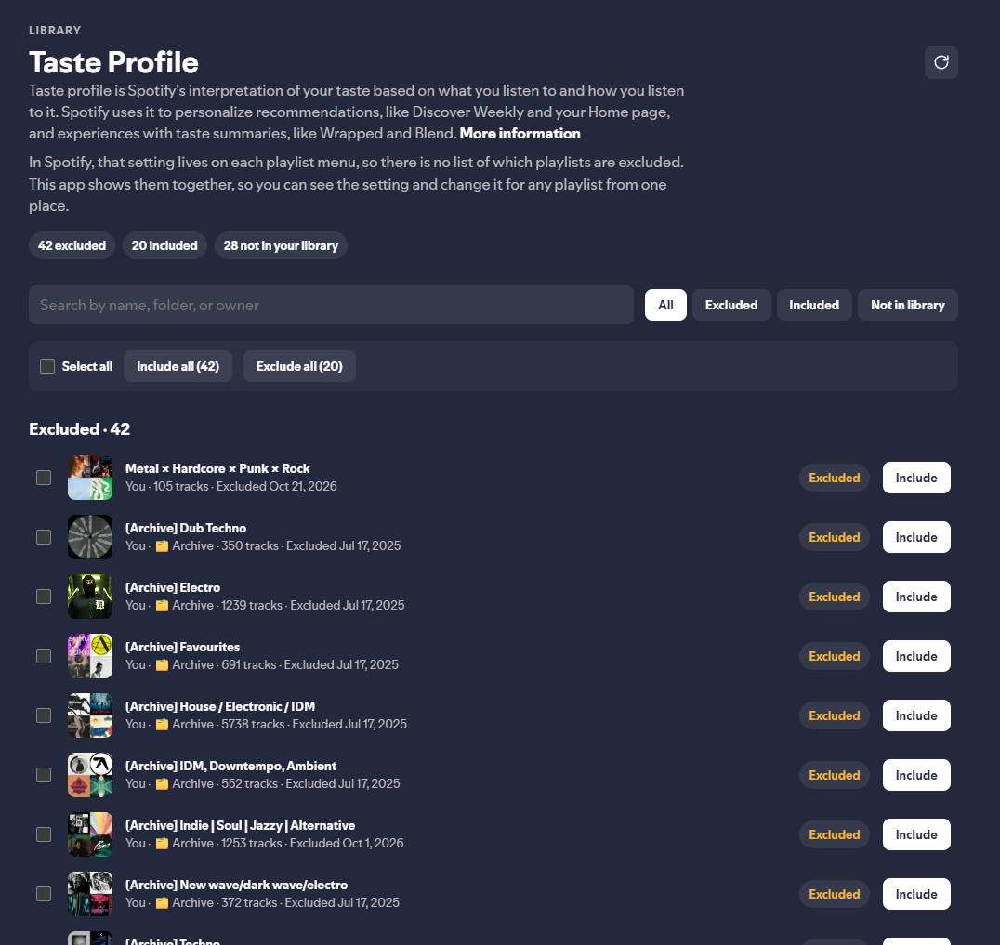
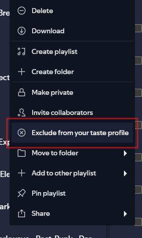

# Taste Profile

Taste profile is Spotify's interpretation of your taste based on what you listen to and how you listen to it. Spotify uses it to personalize recommendations, like Discover Weekly and your Home page, and experiences with taste summaries, like Wrapped and Blend.

[More information](https://support.spotify.com/us/article/exclude-playlists-or-tracks-from-your-taste-profile/)

In Spotify, that setting lives on each playlist menu, so there is no list of which playlists are excluded. This app shows them together, so you can see the setting and change it for any playlist from one place.

Playlists you excluded and later removed from your library stay listed until you include them again.



The same setting in Spotify's playlist menu:



## Install

Copy this folder to your Spicetify custom apps directory. The folder name must stay `taste-profile`.

| Platform | Path |
| --- | --- |
| Windows | `%appdata%\spicetify\CustomApps\taste-profile` |
| macOS / Linux | `~/.config/spicetify/CustomApps/taste-profile` |

Then enable it and restart Spotify:

```bash
spicetify config custom_apps taste-profile
spicetify apply
```

Open **Taste Profile** from the sidebar.

## Uninstall

To remove the app, append a `-` after the folder name:

```bash
spicetify config custom_apps taste-profile-
spicetify apply
```

## Requirements

- [Spicetify](https://spicetify.app/) 2.46 or newer
- A Spotify client that Spicetify has already patched (`spicetify backup apply` on a fresh install)

## Usage

- Filter by **All**, **Excluded**, **Included**, or **Not in library**
- **Not in library** lists playlists you excluded and later removed from your library
- Search by playlist name, folder, or owner
- Lists stay in alphabetical order
- The reload icon beside the title loads the library again and shows progress
- The last filter and search are restored the next time you open the app
- **Exclude** or **Include** updates the same setting as the playlist context menu
- Select playlists to include or exclude them together, or use **Include all** / **Exclude all** for the current view
- **Undo** restores the last change
- Select a playlist name to open it
